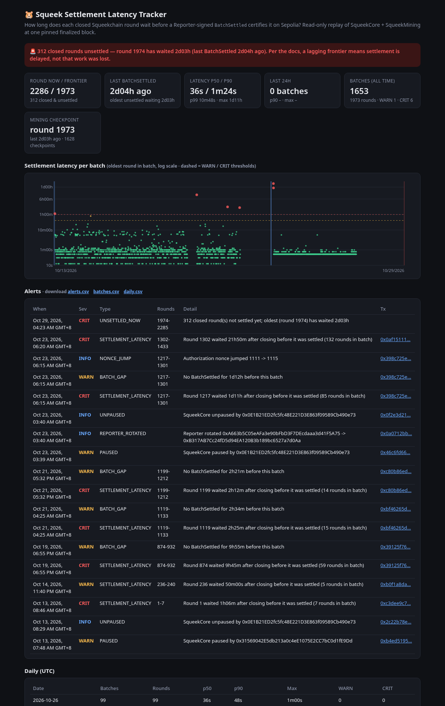

# Squeek Settlement Latency Tracker (Sepolia)

**How long does a closed Squeekchain round wait before it is certified onchain?**

This read-only tool replays every `BatchSettled` event from **SqueekCore** on Sepolia, plus `Paused` / `Unpaused` /
`ReporterUpdated` and **SqueekMining** `Checkpointed`. It measures the delay between a round **closing** and the Reporter-signed
settlement that certifies it. It writes alert CSVs and serves a small local dashboard.



- No wallet and no private keys. It only uses `eth_call`, `eth_getStorageAt`, `eth_getCode`, `eth_getLogs` and `eth_getBlockByNumber`.
- Every run first runs the official [Quickstart](https://docs.squeekchain.com/developers/quickstart/) deployment checks (EIP‑1967 slots, runtime hashes, layout digests, versions, timelock ownership, graph links, launch config) at **one pinned finalized block**. If any check fails, the run stops.
- The event replay is checked against `SqueekCore.state().settledThroughRound` at the same block.

## Quick start
```bash
npm install
npm run verify     # Quickstart verification only
npm run track      # verify + replay + write out/*.csv and out/summary.json
npm run serve      # dashboard at http://localhost:8877 (PORT=… to change)
npm test           # unit tests for the latency/alert logic (offline)
```
Node 20+. The default RPC is the free `https://sepolia.gateway.tenderly.co`. To use your own, run `RPC_URL=https://… npm run track`.
The endpoint must support `eth_getLogs` from block 11902282. The first run fetches about 3k block timestamps, which takes about 2 minutes on the free RPC. They are cached in `.cache/`, so later runs take a few seconds.

## What it measures
The round model comes from the Quickstart: `currentRound = floor((t − genesis) / roundDuration) + 1`. Round *r* closes at `genesis + r·600s`.
Each `BatchSettled` moves the certified frontier from `previousSettledThroughRound` to `settledThroughRound`.

| Metric | Definition |
|---|---|
| `oldestLatencySec` | batch time − close of the first round in the batch (the longest any round waited) |
| `newestLatencySec` | batch time − close of the last round in the batch (how fresh the frontier is) |
| `gapSincePrevSec` | time since the previous `BatchSettled` |
| Unsettled now | closed rounds after the frontier at the pinned block, and how long the oldest one has waited |
| Mining lag | `SqueekMining.state().processedThroughRound` vs the Core frontier |

## Alerts (`out/alerts.csv`)
| Type | Severity |
|---|---|
| `SETTLEMENT_LATENCY` | WARN ≥ `LATENCY_WARN_SEC` (1800), CRIT ≥ `LATENCY_CRIT_SEC` (3600) |
| `BATCH_GAP` | WARN when there is no batch for ≥ `BATCH_GAP_WARN_SEC` (3600) |
| `UNSETTLED_NOW` | closed rounds still waiting at the pinned block (same thresholds) |
| `FRONTIER_DISCONTINUITY` | CRIT: a batch does not start where the previous one ended (would mean missing logs) |
| `NONCE_JUMP` | INFO: the authorization nonce skipped values |
| `PAUSED` / `UNPAUSED` / `REPORTER_ROTATED` | Guardian actions on SqueekCore |
| `MINING_CHECKPOINT_LAG` | INFO: settled rounds not yet processed by a Mining checkpoint |

Other outputs: `out/batches.csv` (one row per settlement), `out/daily.csv` (UTC daily p50/p90/max), and `out/summary.json`.
For cron or CI, `FAIL_ON=CRIT npm run track` exits with code 2 while the current state is critical.

## Reporter rotation
The docs list Reporter `0xA663…5A75`. Onchain, the Guardian rotated it to `0xB317…d0Aa` at block 11971684 (2026‑10‑22 19:40 UTC), while SqueekCore was paused.
Rather than hard-coding an override, the tracker starts from the documented reporter and follows every onchain `ReporterUpdated` event. The chain of events must be unbroken, and `hasEverBeenReporter(docsReporter)` must be true.
`SQUEEK_STRICT=1` turns this off and requires the docs value exactly. Strict mode currently fails after that block, as the docs rule intends.

## Example findings (block 12014655, 2026‑10‑28 20:17 UTC)
- 1653 batches settled rounds 1–1973. Settlement latency was p50 36 s, p90 1 m 24 s, p99 10 m 48 s.
- Big delays: 9 h 45 m (rounds 874–932, Oct 19), 2 h 25 m and 2 h 12 m (Oct 20–21), and 1 d 11 h for round 1217, which was settled in an 85-round catch-up batch right after the pause and reporter rotation on Oct 22.
- **Live stall**: no `BatchSettled` since round 1973 (about 2 days). Over 300 closed rounds are unsettled. Per the docs, this means settlement is delayed, not that work was lost.

## Files
- `src/chain.ts`: client, chain check, pinned block, Quickstart verification, reporter-rotation resolver, chunked `getLogs`
- `src/track.ts`: one tracker run (scan, timestamps, analysis)
- `src/latency.ts`: pure latency, alert, stats and CSV logic (tested in `test/latency.test.ts`)
- `track.ts`, `verify.ts`: CLIs. `web/server.ts` and `web/index.html`: the dashboard
- `abi/*.json`: official ABIs (release `squeeks-sepolia-core3-mining6-001`). `src/abis.ts` is generated from them (`npm run gen:abi`)
- `sepolia.json`, `sepolia-env.sh`: official deployment record and environment values from https://docs.squeekchain.com/developers/

MIT licensed. Sepolia testnet only.
